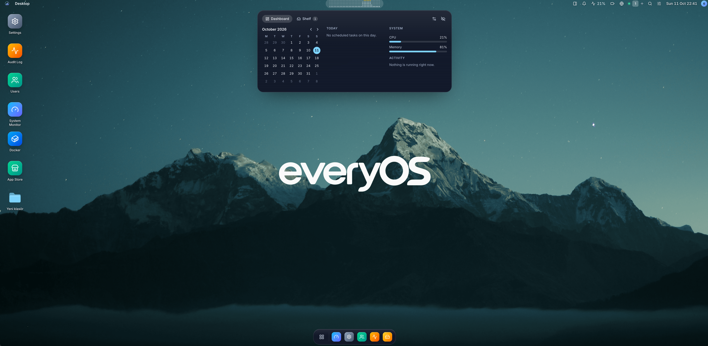
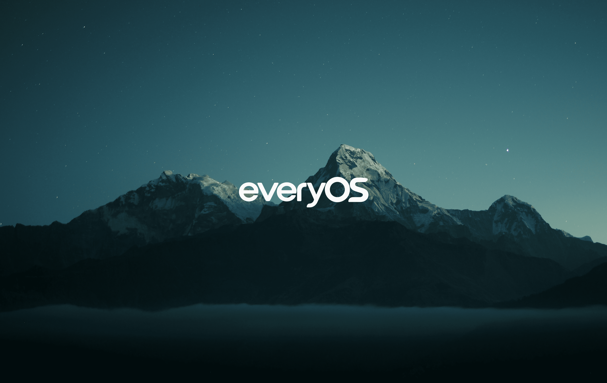

<p align="center">
  <picture>
    <source media="(prefers-color-scheme: dark)" srcset="apps/web/public/everyos-white.png" />
    
  </picture>
</p>

<h1 align="center">Your personal OS, in your browser.</h1>

<p align="center">
  Your files. Your apps. Your own space.<br />
  A personal desktop, powered by the Linux machine you control.
</p>

<p align="center">
  <a href="#get-started">Get started</a> ·
  <a href="https://github.com/goktugcy/everyos/releases">Releases</a> ·
  <a href="#explore-everyos">Features</a> ·
  <a href="#documentation">Documentation</a>
</p>

<p align="center">
  
</p>

<p align="center"><em>A workspace that feels like yours, wherever you open it.</em></p>

## Meet EveryOS

EveryOS is a self-hosted **personal OS experience** that brings your files, applications and
workspace together in a browser. It runs on your existing Linux installation and gives you a
familiar desktop: windows, folders, a dock, search, settings and a space to make your own.

Keep documents in your personal home, organize your desktop, install self-hosted apps and see
what your machine is doing. Open the same workspace from a laptop or use the mobile interface
from your phone. Your data lives on the machine you choose to host it on.

The interface is available in **Turkish and English**, with Turkish as the default.

## Explore EveryOS

### A desktop that remembers you

Move and resize windows, snap them into place and return to your saved layout. Switch between
virtual desktops, pin apps to the dock and find them through the launcher. Widgets, notifications
and the Pulse shelf keep useful information close to your work.

### Your files, at home

Each account has a private home with Desktop, Documents, Downloads, Pictures, Music and Videos.
The desktop shows the contents of your Desktop folder, so folders and files behave consistently
across views. Select several items, draw a selection rectangle, drag between folders, preview
images and edit text. Deleted files go to a private trash where they can be restored.

Administrators can also make selected host locations available with explicit access rules.
Learn more in the [file manager guide](docs/files.md).

### Apps on your own machine

Browse supported catalogs in the App Store, install self-hosted applications and follow their
deployment progress. Open the Docker app to inspect containers and manage supported lifecycle
actions. EveryOS distinguishes its own deployments from external and protected resources.

App updates, deployment rollback and selected app-data backups are part of the same workspace.
Docker must be installed on the host to use these features; the EveryOS installer does not install
it automatically. See the [App Store](docs/app-store.md) and [Docker](docs/docker-management.md) guides.

### Make it look like you

Start with the EveryOS mountain wallpaper, then choose a different background, upload your own
image or give each virtual desktop its own look. Seven themes, accent colors, glass effects,
icon sizes and rendering modes let you adjust the interface to your device and taste.

Choose a folder-icon preset or use your own image, globally or for an individual folder.
Your appearance settings stay with your account.

<details>
<summary>View the default EveryOS wallpaper</summary>



[Download the original wallpaper](apps/web/public/wallpapers/everyos-mountains.png) ·
[Visual identity and assets](docs/branding.md)

</details>

### Linux, within reach

See real CPU, memory, storage and network readings in System Monitor. Inspect services and logs,
manage host packages and schedule supported tasks. The menu bar shows battery and power details
when the Linux host exposes those sensors, including charging state and watts where available.

The browser terminal connects to a real shell with independent windows and themes. An administrator
must first configure a regular Linux account for terminal access; see [terminal.md](docs/terminal.md).
Unavailable host capabilities are explained in the interface.

### Your workspace, backed up

Backups include the database, configuration, wallpapers and personal home folders, including
desktop files and trash. Choose app data separately, verify archives and restore through the
authenticated workflow. EveryOS version updates are available from **Settings → About**,
**Updates → EveryOS** and the CLI, with signed packages and supervised recovery.

See [backups](docs/backups.md) and [updates](docs/updates.md) for the operating details.

## Get started

Install on a fresh **Debian 12+, Ubuntu 22.04+ or compatible APT/systemd host**, using
**ARM64 or AMD64**. The detailed kernel, glibc and systemd requirements are in the
[installation guide](docs/packaging.md).

```bash
curl -fsSL https://github.com/goktugcy/everyos/releases/latest/download/install.sh | sudo bash
```

The installer selects your architecture, installs missing prerequisites and verifies the signed
release and package. The application includes its Node.js runtime; no repository clone, Node.js
setup or pnpm installation is required.

The one-command path trusts the bootstrap delivered over HTTPS by the official GitHub release.
For script inspection and independent publisher-key and signature verification, use the
[manual installation instructions](docs/packaging.md#first-installation).

### Open your workspace

1. On the Linux host, read the one-time setup token:

   ```bash
   sudo cat /var/lib/everyos/setup-token
   ```

2. Open one of the network addresses printed by the installer, such as `http://192.168.1.20:7470`
   or your host's Tailscale IPv4 address. Fresh packages from 0.1.1 listen on all IPv4 interfaces,
   including loopback. A client using the Tailscale address must be connected to the same tailnet.
   Use an HTTPS reverse proxy or [Tailscale Serve](docs/tailscale.md) for browser HTTPS access.
3. Complete the setup wizard, create your administrator account and make the desktop your own.

For an existing EveryOS installation, use **Settings → About** to check for and install a version
update. The initial-installation command refuses an existing database.

## Built around your control

- **Private accounts.** Personal home folders, server-side sessions, optional two-factor
  authentication and recovery codes.
- **Explicit permissions.** Administrator, Operator and Viewer roles, with permissions enforced
  by the API and agent and security-relevant actions recorded in the audit log.
- **A separate privilege boundary.** The API runs unprivileged; host-management operations pass
  through a validated agent registry. The configured interactive terminal uses its Linux account's
  ordinary permissions.
- **Verified updates.** Publisher signatures, package identity and hashes are checked before
  installation. A supervised worker handles version updates and package/database recovery.

Read the [security model](docs/security-model.md) or use [SECURITY.md](SECURITY.md) to report a vulnerability.

## Project status

EveryOS is in its first public release cycle. This README describes the current source tree;
installed packages contain the code and assets from their release tag. The 0.1.1 packages include
automatic network access for new installations and the default mountain wallpaper.

Linux installation, updates and recovery have recorded disposable-host acceptance results.
Recorded CI runs contain outstanding browser-test failures covering folder icons,
file-manager interactions and terminal themes. Validation and its limits are documented in
[phase8-acceptance.json](docs/phase8-acceptance.json); planned work is in the [roadmap](docs/roadmap.md).

## Development

Use **Node.js 26** and **pnpm 12**:

```bash
pnpm install
pnpm dev
```

Open `http://127.0.0.1:5173`. The development stack prints its temporary setup token in the console.

```bash
pnpm check
pnpm build
pnpm test:e2e
```

The React client, Hono API, SQLite database, privileged agent and update worker are described in
the [architecture guide](docs/architecture.md). See [development.md](docs/development.md) and
[CONTRIBUTING.md](CONTRIBUTING.md) to work on the project.

## Documentation

| Start here                          | Guide                                                                                   |
| ----------------------------------- | --------------------------------------------------------------------------------------- |
| Installation, CLI and recovery      | [Packaging](docs/packaging.md)                                                          |
| Host configuration                  | [Configuration](docs/configuration.md)                                                  |
| Files, homes and trash              | [Files](docs/files.md)                                                                  |
| Self-hosted applications            | [App Store](docs/app-store.md)                                                          |
| Docker resources                    | [Docker management](docs/docker-management.md)                                          |
| Browser shell access                | [Terminal](docs/terminal.md)                                                            |
| Personalization and visual assets   | [Branding](docs/branding.md) · [Folder icons and power](docs/power-and-folder-icons.md) |
| Widgets and integrations            | [Widgets](docs/widgets.md)                                                              |
| Scheduled operations                | [Tasks](docs/tasks.md)                                                                  |
| Data protection and version updates | [Backups](docs/backups.md) · [Updates](docs/updates.md)                                 |
| Remote access                       | [Tailscale](docs/tailscale.md)                                                          |
| APIs and extensions                 | [API](docs/api.md) · [Contracts](docs/contracts.md)                                     |

## License

The license has not been chosen yet. Until a `LICENSE` file is added, all rights are reserved by
the author.
