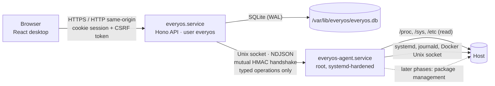
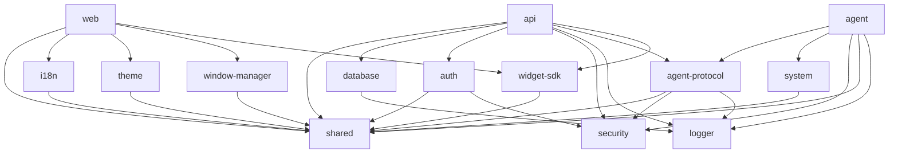

# EveryOS architecture

EveryOS is a **modular monolith** with three runtime responsibilities and exactly two long-running
processes on the host:

| Process                 | Runs as                  | Listens on                                                  | Responsibility                                                                             |
| ----------------------- | ------------------------ | ----------------------------------------------------------- | ------------------------------------------------------------------------------------------ |
| `everyos.service`       | `everyos` (unprivileged) | TCP `127.0.0.1:7470` by default (configurable)              | HTTP API, sessions, authorization, SQLite, serving the web client, background maintenance  |
| `everyos-agent.service` | `root` (hardened unit)   | Unix socket `/run/everyos/agent.sock` (`root:everyos 0660`) | Executes a fixed registry of validated host operations requested by the API                |
| Web client              | the user's browser       | –                                                           | Desktop UI. Never performs privileged work; talks only to the API over same-origin HTTP(S) |



The browser never reaches the agent, and the API never runs privileged code itself. The API is the
only component that authenticates humans; the agent authenticates the API and re-checks every
request against its own operation registry and policy.

## Repository layout

```text
apps/
  api/        Hono HTTP API (entry: src/main.ts, composition: src/app.ts)
  agent/      privileged agent (entry: src/main.ts, handlers + policy)
  web/        React + Vite web client
packages/
  shared/         zod-free contracts (types, permissions, error codes) + "/schemas" (zod)
  i18n/           translation resources (tr source, en default + 8 languages); typed so missing keys fail typecheck
  logger/         dependency-free structured JSON logger with secret redaction
  database/       node:sqlite wrapper, transactions, migrations with pre-migration backups
  auth/           scrypt password hashing, password policy, RFC 6238 TOTP, recovery codes
  security/       master key files, AES-256-GCM secret box, HKDF subkeys, constant-time helpers
  agent-protocol/ API⇄agent protocol: framing, handshake, operation registry, client and server
  system/         host introspection (/proc, /sys, /etc) with capability detection
  theme/          zod-free theme resolution, contrast adjustment, CSS tokens and theme import/export
  window-manager/ framework-independent window state, geometry, snapping and persistence
  widget-sdk/     browser-safe built-in widget manifests, layout, configuration and adapter detection
scripts/      dev orchestrator and production build
tests/e2e/    Playwright end-to-end tests against the built artifacts
docs/         developer documentation (this folder)
```

Packages are only created when they have real content. Planned packages from the product
specification (`desktop`, `widgets`, `widget-sdk`, `app-store`,
`catalog-adapters`, `app-installer`, `docker`, `notifications`, `ui`) are introduced in the phase
that implements them (see [roadmap.md](roadmap.md)).

### Package dependency rules



- `@everyos/shared` (root entry) must stay **runtime-agnostic and zod-free** so the browser bundle
  does not ship server-side validation. Zod schemas live in `@everyos/shared/schemas`.
- Node-only packages (`database`, `auth`, `security`, `system`, `logger`, `agent-protocol`) are
  never imported by `apps/web`.
- No cycles. The agent depends on the smallest possible set of third-party packages (`zod`, `yaml`)
  because it runs as root.
- The API never imports `@everyos/system` at runtime (it has no host access of its own). Its tests
  use the development Docker simulator from that package through a dev dependency, so API tests
  exercise the same simulated Docker the development agent serves.

## Runtime and build decisions

- **Node.js 26** (LTS from 2026-10-28, supported until 2029-04-30). Development runs TypeScript
  directly through Node's built-in type stripping (`erasableSyntaxOnly` is enforced), so there is
  no transpiler in the dev loop.
- **No native addons.** SQLite comes from `node:sqlite`, password hashing from `node:crypto`
  (scrypt). A production build is two self-contained ESM bundles produced by esbuild
  (`dist/api/server.mjs`, `dist/agent/agent.mjs`) plus the static web client. The same files run
  on ARM64 and AMD64; packaging only adds the matching Node runtime.
- **TypeScript 6.0** (not 7): typescript-eslint does not support the Go-based TypeScript 7 yet.

Details and alternatives considered are recorded in [decisions.md](decisions.md).

## Docker management (Phase 4)

`packages/system/src/docker` implements bounded HTTP requests to Docker Engine over a Unix
socket, API version negotiation, safe view parsers, log demultiplexing and controlled Compose CLI
execution. Only the agent imports this backend at runtime. Fixed registered Docker operations
carry permissions, schemas, timeouts and a development-mode mutation guard.

The API stores explicit Compose imports in SQLite (`docker_projects`, migration 0003). Labels
provide discovery metadata and manager hints; they never grant EveryOS ownership. `DockerHub`
samples running containers every 5 s while subscribed, derives rates from cumulative counters,
keeps up to 15 minutes of history for at most 300 containers, and relays lifecycle events through
the shared `docker` SSE topic. History resets on API restart.

The lazy Docker desktop/mobile app displays grouped containers, ownership, health/security risks,
detail, live logs/charts, Compose imports/actions and image/volume/network inventories. See
[docker-management.md](docker-management.md) for ownership rules and verification limits.

## Widget platform (Phase 6)

`@everyos/widget-sdk` holds the built-in manifests and the pure layout, configuration,
compatibility and adapter-detection logic. The web client and the API share it. The API's
`DataHub` (`apps/api/src/modules/widgets`) runs one reference-counted collector per data topic and
filters results per subscriber:

- **System topics** call fixed agent operations, including the new read-only `network.sockets`,
  `apt.updates` and `services.timers`.
- **Integration topics** call `IntegrationService` (`apps/api/src/modules/integrations`). It
  reads app APIs with an SSRF-checked HTTP client using sealed credentials (migration 0007), and
  reads PostgreSQL statistics through the agent.

Topics travel on the existing per-tab SSE stream as `event: data`. The desktop renders widgets on
an 80 px grid layer between the icons and the windows, in a 320 px sidebar that shrinks the window
work area, and in the menu bar. See [widgets.md](widgets.md).

## Advanced tools (Phase 7)

Each tool is an API module with its own service, routes and document, built on the existing
pieces (agent operations, SSE stream, audit log) rather than new infrastructure:

- **Notifications** (`modules/notifications`): `NotificationService` (conditions and events in
  SQLite), `HostMonitor` (background checks every two minutes), live delivery on the SSE stream.
- **Files** (`modules/files`): `FileService` in the API's own identity over configured roots.
- **Updates** (`modules/updates`): background apt jobs through the agent's `AptManager`, one at a
  time, with streamed output and history.
- **Scheduler** (`modules/tasks`): a 30-second clock, cron parsing in `@everyos/shared`, and
  executors that call the same services as the interactive features.
- **Backups** (`modules/backups`): `BackupStore` (directories, manifests, verification, transfer),
  database snapshots and staged restores (`snapshot.ts`, applied by `main.ts` before the database
  opens), and `BackupService` jobs. App data goes through the agent's `AppDataBackups` in chunks;
  `@everyos/system/archive` is the shared tar implementation.
- **Tailscale** (`modules/system/tailscale.ts`): read-only LocalAPI details from the agent and an
  analysis of remote access and warnings, used by the API route and the host monitor.

## Request lifecycle (API)

1. `requestContext` assigns a request id and resolves the client (IP, HTTPS, host). Forwarded
   headers count only when the direct peer is a configured trusted proxy.
2. `securityHeaders` sets a strict CSP and related headers on every response.
3. `bodyLimit` caps JSON bodies at 64 KiB. Wallpaper uploads use their own streaming 10 MiB cap.
4. `loadSession` resolves the session cookie to a user. Permissions are recomputed from the user's
   current role on every request.
5. `csrfProtection` checks Fetch Metadata, `Origin`, and the per-session CSRF token header for
   state-changing requests.
6. `enforceUnlocked` rejects protected requests from locked sessions with HTTP 423. Public bootstrap
   and lock-screen reads remain available.
7. The route handler validates input with zod (`parseJsonBody` / `parseQuery` / `parseParams`), checks permissions
   (`requirePermission`) and records audit events for security-relevant actions.
8. Errors are converted to `{ error: { code, message, details? } }`. The code is stable and
   localized by the client (`errors.<CODE>` translation keys).

## Data storage

SQLite (`/var/lib/everyos/everyos.db`) in WAL mode with `synchronous=NORMAL` and foreign keys on.

- Migrations live in `packages/database/src/migrations`. They are numbered consecutively and append-only.
  Each runs in its own transaction.
- Before an existing database is migrated, an online backup is written to
  `/var/lib/everyos/backups/pre-migration-v<from>-to-v<to>-<timestamp>.db`. The last 5 are kept.
- If the database was migrated by a newer EveryOS release, startup is refused instead of risking data
  loss.
- High-frequency metrics are **not** stored in SQLite. Phase 3 keeps them in memory with bounded
  ring buffers.

Phase 1 tables: `users`, `sessions`, `recovery_codes`, `user_preferences`, `instance_settings`,
`audit_events`.

Phase 2 adds `sessions.locked_at` and `wallpapers`; `user_preferences` stores versioned appearance,
desktop, dock, menu-bar, window-session and security documents. Wallpaper files are owned by the API
user and are served only after session ownership checks.

Phase 7 adds `notifications` and `notification_states` (0008), `update_jobs` (0009), and
`scheduled_tasks` and `task_runs` (0010). Backup settings are an `instance_settings` row; backups
themselves are files (their history must survive a database restore).

## Desktop client (Phase 2)

`apps/web/src/desktop` contains the static application registry, desktop/mobile shells, menus,
launcher, dock, icon/folder operations and the thin React binding to `@everyos/window-manager`.
System, Settings, Users, Audit and Files apps load lazily and each window has an error boundary.
System data comes from the existing real agent operation. The desktop shows the app shortcuts and,
like macOS, the contents of the user's home Desktop folder (docs/files.md).

Drag/resize previews update frame DOM styles once per animation frame; committed geometry updates
the store after release. App content is memoized and keeps a stable component identity. Snap zones,
tiling, viewport clamping and proportional layout restoration live in the window-manager package.
Below 768 px the shell presents one full-screen app at a time. Switching between shells preserves
the window session; user state is cleared only when the signed-in session ends.

The theme package resolves seven presets plus validated custom themes into CSS variables. It
clamps surface opacity for text contrast, applies Performance/Balanced/Premium effect limits and
exports data-only JSON. Preference writes are ordered per key, coalesced and scoped to the signed-in
session. A failed load remains visible with a retry action.

The menu bar, window chrome and icon labels follow macOS (a menu bar without background, traffic
lights, plate-less labels). The pulse (`apps/web/src/desktop/pulse`) is a dot matrix in the menu bar
that shows the server's CPU history and running jobs; it opens a dashboard (calendar of scheduled
task runs, live system values, jobs) and a file shelf; see [pulse.md](pulse.md).

## Host integration (Phase 3)

```
 /proc, /sys, statfs ─┐                               ┌─► GET /api/system/* (REST)
 systemctl --output=json ├─► agent collectors ─NDJSON─► API ─┼─► MetricsHub ─► SSE /api/events
 journalctl --output=json│   (raw counters,     socket       │   (rates, ring buffers)
 Tailscale LocalAPI ──┘    no rates)                     └─► SSE /api/logs/stream
```

- **Agent (`packages/system`)** reads cheap kernel interfaces directly and parses tool output in
  pure, fixture-tested functions (`src/linux/*`). Collectors return raw cumulative counters; they
  never compute rates, so a sample is a single consistent reading.
- **API `MetricsHub`** samples `metrics.sample` every 2 s only while a live subscriber exists and
  every 60 s in the background. It derives rates from consecutive samples (counter resets yield
  `null`, never negative values) and keeps 15 minutes of live points plus 24 hours of minute
  averages in bounded in-memory buffers (≤ 450 + 1440 points). History is intentionally not
  persisted in Phase 3.
- **One event stream per tab** (`/api/events?topics=…`) carries live metrics to the menu bar module,
  the System Monitor and future widgets; the browser closes it while the tab is hidden.
- **Services and logs** go through `ServiceManager` / `LogSource` interfaces with two
  implementations: systemd/journald on Linux and an in-memory simulator used only in development.
- **Web apps:** System Monitor (overview charts, storage, network + Tailscale, processes, hardware,
  info), Services and Logs. Charts are dependency-free SVG with crosshair tooltips, keyboard
  navigation and a table view for every chart.

## Host filesystem layout (production)

| Path                       | Owner / mode       | Contents                                                                                                                                                            |
| -------------------------- | ------------------ | ------------------------------------------------------------------------------------------------------------------------------------------------------------------- |
| `/usr/lib/everyos/`        | root, 0755         | program files: Node runtime, `api/`, `agent/`, `web/`                                                                                                               |
| `/etc/everyos/config.yaml` | root:everyos, 0640 | API configuration (optional; secure defaults apply without it)                                                                                                      |
| `/etc/everyos/agent.yaml`  | root, 0600         | agent configuration and policy (never writable by `everyos`)                                                                                                        |
| `/etc/everyos/agent.key`   | root:everyos, 0640 | shared key for the API⇄agent handshake (created by the agent)                                                                                                       |
| `/var/lib/everyos/`        | everyos, 0750      | `everyos.db`, `backups/` (pre-migration and pre-restore databases, `archives/`), `restore/` (a staged restore), `secret.key` (0600), `setup-token` (first run only) |
| `/run/everyos/`            | root:everyos, 0750 | `agent.sock` (0660)                                                                                                                                                 |
| `/var/log/everyos/`        | –                  | reserved; logs go to journald                                                                                                                                       |

App Store data and root-owned deployment records live under `/var/lib/everyos/apps/<instance>`
(private root and instance directories). Application removal preserves its data. Decrypted embedded
configuration uses private root-owned tmpfs at `/run/everyos/app-configs/<instance>`; durable
configuration stays encrypted. See [app-store.md](app-store.md).

## Development mode

`pnpm dev` starts the agent, the API and Vite with `EVERYOS_ENV=development` and all state under
`./.dev`. Development mode:

- refuses to run as root (both the orchestrator and the agent);
- uses `0600` sockets and keys owned by the developer;
- reports real data where the host provides it (on macOS, Linux-only capabilities show as
  unavailable with reason `not-linux`). Service and log operations fall back to an in-memory
  simulator when systemd/journald are missing; simulated data is marked `source: "simulated"` and
  labeled as such in the UI;
- never changes real host services: the development agent's policy denies them.

See [development.md](development.md).
