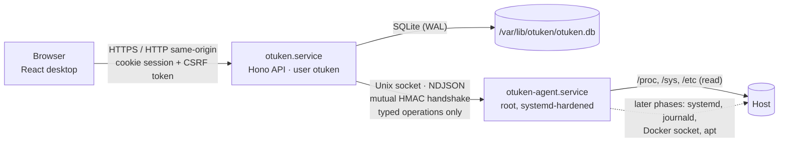
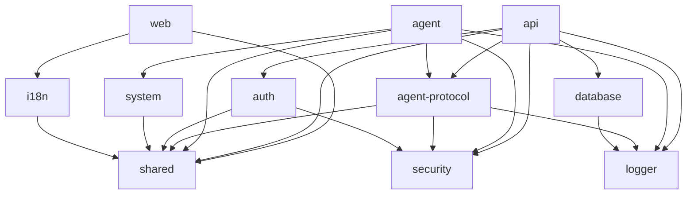

# Otuken architecture

Otuken is a **modular monolith** with three runtime responsibilities and exactly two long-running
processes on the host:

| Process                | Runs as                 | Listens on                                                | Responsibility                                                                             |
| ---------------------- | ----------------------- | --------------------------------------------------------- | ------------------------------------------------------------------------------------------ |
| `otuken.service`       | `otuken` (unprivileged) | TCP `127.0.0.1:7470` by default (configurable)            | HTTP API, sessions, authorization, SQLite, serving the web client, background maintenance  |
| `otuken-agent.service` | `root` (hardened unit)  | Unix socket `/run/otuken/agent.sock` (`root:otuken 0660`) | Executes a fixed registry of validated host operations requested by the API                |
| Web client             | the user's browser      | –                                                         | Desktop UI. Never performs privileged work; talks only to the API over same-origin HTTP(S) |



The browser never reaches the agent, and the API never runs privileged code itself. The API is the
only component that authenticates humans; the agent authenticates the API and re-checks every
request against its own operation registry and policy.

## Repository layout

```text
apps/
  api/        Hono HTTP API (entry: src/main.ts, composition: src/app.ts)
  agent/      privileged agent (entry: src/main.ts, handlers + policy)
  web/        React + Vite web client
packages/
  shared/         zod-free contracts (types, permissions, error codes) + "/schemas" (zod)
  i18n/           translation resources (tr default, en); typed so missing keys fail typecheck
  logger/         dependency-free structured JSON logger with secret redaction
  database/       node:sqlite wrapper, transactions, migrations with pre-migration backups
  auth/           scrypt password hashing, password policy, RFC 6238 TOTP, recovery codes
  security/       master key files, AES-256-GCM secret box, HKDF subkeys, constant-time helpers
  agent-protocol/ API⇄agent protocol: framing, handshake, operation registry, client and server
  system/         host introspection (/proc, /sys, /etc) with capability detection
scripts/      dev orchestrator and production build
tests/e2e/    Playwright end-to-end tests against the built artifacts
docs/         developer documentation (this folder)
```

Packages are only created when they have real content. Planned packages from the product
specification (`desktop`, `window-manager`, `widgets`, `widget-sdk`, `app-store`,
`catalog-adapters`, `app-installer`, `docker`, `notifications`, `ui`) are introduced in the phase
that implements them (see [roadmap.md](roadmap.md)).

### Package dependency rules



- `@otuken/shared` (root entry) must stay **runtime-agnostic and zod-free** so the browser bundle
  does not ship server-side validation. Zod schemas live in `@otuken/shared/schemas`.
- Node-only packages (`database`, `auth`, `security`, `system`, `logger`, `agent-protocol`) are
  never imported by `apps/web`.
- No cycles. The agent depends on the smallest possible set of third-party packages (`zod`, `yaml`)
  because it runs as root.

## Runtime and build decisions

- **Node.js 26** (LTS from 2026-10-28, supported until 2029-04-30). Development runs TypeScript
  directly through Node's built-in type stripping (`erasableSyntaxOnly` is enforced), so there is
  no transpiler in the dev loop.
- **No native addons.** SQLite comes from `node:sqlite`, password hashing from `node:crypto`
  (scrypt). A production build is two self-contained ESM bundles produced by esbuild
  (`dist/api/server.mjs`, `dist/agent/agent.mjs`) plus the static web client. The same files run
  on ARM64 and AMD64; packaging only adds the matching Node runtime.
- **TypeScript 6.0** (not 7): typescript-eslint does not support the Go-based TypeScript 7 yet.

Details and alternatives considered are recorded in [decisions.md](decisions.md).

## Request lifecycle (API)

1. `requestContext` assigns a request id and resolves the client (IP, HTTPS, host). Forwarded
   headers count only when the direct peer is a configured trusted proxy.
2. `securityHeaders` sets a strict CSP and related headers on every response.
3. `bodyLimit` caps JSON bodies at 64 KiB.
4. `loadSession` resolves the session cookie to a user. Permissions are recomputed from the user's
   current role on every request.
5. `csrfProtection` checks Fetch Metadata, `Origin`, and the per-session CSRF token header for
   state-changing requests.
6. The route handler validates input with zod (`parseJsonBody` / `parseQuery`), checks permissions
   (`requirePermission`) and records audit events for security-relevant actions.
7. Errors are converted to `{ error: { code, message, details? } }`. The code is stable and
   localized by the client (`errors.<CODE>` translation keys).

## Data storage

SQLite (`/var/lib/otuken/otuken.db`) in WAL mode with `synchronous=NORMAL` and foreign keys on.

- Migrations live in `packages/database/src/migrations`. They are numbered consecutively and append-only.
  Each runs in its own transaction.
- Before an existing database is migrated, an online backup is written to
  `/var/lib/otuken/backups/pre-migration-v<from>-to-v<to>-<timestamp>.db`. The last 5 are kept.
- If the database was migrated by a newer Otuken release, startup is refused instead of risking data
  loss.
- High-frequency metrics are **not** stored in SQLite. Phase 3 keeps them in memory with bounded
  ring buffers.

Phase 1 tables: `users`, `sessions`, `recovery_codes`, `user_preferences`, `instance_settings`,
`audit_events`.

## Host filesystem layout (production)

| Path                      | Owner / mode      | Contents                                                                     |
| ------------------------- | ----------------- | ---------------------------------------------------------------------------- |
| `/usr/lib/otuken/`        | root, 0755        | program files: Node runtime, `api/`, `agent/`, `web/`                        |
| `/etc/otuken/config.yaml` | root:otuken, 0640 | API configuration (optional; secure defaults apply without it)               |
| `/etc/otuken/agent.yaml`  | root, 0600        | agent configuration and policy (never writable by `otuken`)                  |
| `/etc/otuken/agent.key`   | root:otuken, 0640 | shared key for the API⇄agent handshake (created by the agent)                |
| `/var/lib/otuken/`        | otuken, 0750      | `otuken.db`, `backups/`, `secret.key` (0600), `setup-token` (first run only) |
| `/run/otuken/`            | root:otuken, 0750 | `agent.sock` (0660)                                                          |
| `/var/log/otuken/`        | –                 | reserved; logs go to journald                                                |

Application data managed by Otuken (Phase 5) lives outside the program and state directories, under
a configurable data root, so removing or upgrading Otuken never touches it.

## Development mode

`pnpm dev` starts the agent, the API and Vite with `OTUKEN_ENV=development` and all state under
`./.dev`. Development mode:

- refuses to run as root (both the orchestrator and the agent);
- uses `0600` sockets and keys owned by the developer;
- reports real data where the host provides it (on macOS, Linux-only capabilities show as
  unavailable with reason `not-linux`). Any simulated data is marked `source: "simulated"` and
  labeled as such in the UI.

See [development.md](development.md).
