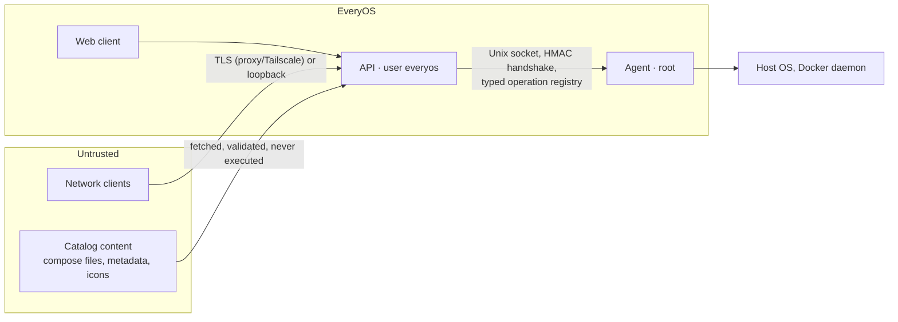

# EveryOS security model

EveryOS manages a server: anyone who controls an administrator session can, by design, change the
host. The security model therefore concentrates on (1) making sure only the right people get a
session, (2) limiting what each role can do, (3) keeping the privileged component small and
non-generic, and (4) leaving an audit trail.

Status legend: **[P1]** implemented and tested in Phase 1, **[planned]** designed but not yet
implemented.

## Trust boundaries

| Boundary       | Control                                                                                                                            |
| -------------- | ---------------------------------------------------------------------------------------------------------------------------------- |
| Network → API  | Loopback-only default bind, session cookies, CSRF defenses, rate limiting, strict input validation, security headers **[P1]**      |
| API → Agent    | Socket file permissions + mutual HMAC handshake, operation allowlist, zod validation, per-operation permission and policy **[P1]** |
| Catalogs → API | SSRF-safe fetch, size and time limits, no script execution, install policy checks **[planned, Phase 5]**                           |
| Web client     | No privileged logic; strict CSP; untrusted text rendered as text, never as HTML **[P1]**                                           |

## Network exposure

- The verified installer from 0.1.2 enables `0.0.0.0:7470` only for a new API configuration.
  Packaged defaults, generic API fallbacks and development remain loopback-only **[P1]**;
  this prevents dpkg upgrades from broadening an unchanged older configuration.
  Administrators can set `server.host: 127.0.0.1` for proxy-only access. The API logs a warning when it
  listens on a non-loopback address without TLS **[P1]**.
- Recommended remote access is through Tailscale (`tailscale serve`) or a TLS reverse proxy. Direct
  TLS is supported with `server.tls` **[P1]**.
- `X-Forwarded-For`, `X-Forwarded-Proto` and `X-Forwarded-Host` are honoured only when the direct
  peer is listed in `server.trustedProxies` (IPs or CIDRs). The client address is the first
  untrusted hop from the right **[P1]**.
- The UI warns when the connection is plain HTTP from a non-loopback address; plain HTTP is never
  silently treated like HTTPS **[P1]**.
- EveryOS never opens firewall ports **[policy]**.

## Authentication

| Mechanism                | Details                                                                                                                                                                                                                                                                                                                                                      |
| ------------------------ | ------------------------------------------------------------------------------------------------------------------------------------------------------------------------------------------------------------------------------------------------------------------------------------------------------------------------------------------------------------ |
| First-run setup **[P1]** | `POST /api/setup` works only while no user exists, and requires a one-time token. The token is written to `/var/lib/everyos/setup-token` (mode 0600) and is readable only by the `everyos` user and root. The token file is deleted after setup and the endpoint answers `409` from then on. Admin creation re-checks "no users" inside a write transaction. |
| Passwords **[P1]**       | scrypt (N=2¹⁶, r=8, p=2, 16-byte salt, self-describing format with transparent rehash when parameters increase). Unicode NFKC normalization. The policy requires 10–256 characters, rejects passwords that contain the username or are common, and rejects repetitive ones.                                                                                  |
| Timing **[P1]**          | Unknown usernames run a dummy verification so response time does not reveal which accounts exist. Unknown user and wrong password return the same error.                                                                                                                                                                                                     |
| Sessions **[P1]**        | 256-bit random token in an `HttpOnly`, `SameSite=Strict` cookie (`__Host-` prefix and `Secure` over HTTPS). Only the SHA-256 of the token is stored. Sessions have a 12 h idle timeout and a 7-day absolute lifetime (both configurable). Logout, password change, account disabling and admin password resets revoke sessions server-side.                  |
| Second factor **[P1]**   | Optional TOTP (RFC 6238, SHA-1, 30 s, 6 digits, ±1 step) with replay protection: the last accepted step is persisted. The challenge is bound to the client IP, valid for 5 minutes, and allows at most 5 attempts. Users get 10 single-use recovery codes, stored as hashes. Disabling 2FA requires the password and a valid code.                           |
| Brute force **[P1]**     | In-memory progressive lockouts per IP (20 failures / 15 min) and per account (5 failures, lock starting at 1 min, doubling up to 15 min). Re-authentication inside a session is limited separately. Lockouts are temporary by design, so an attacker cannot permanently lock out the administrator.                                                          |

## Authorization

- Roles are bundles of fine-grained permissions (`packages/shared/src/permissions.ts`) **[P1]**:
  - **admin**: all permissions.
  - **operator**: day-to-day operations (services, Docker, apps, files, creating and managing
    backups, tasks, logs). No user management, settings, catalog trust, terminal, audit log,
    package upgrades, or restoring and downloading backups (`backups:restore`) **[P7]**.
  - **viewer**: read-only system, services, Docker, apps and notifications.
- Every route declares the permission it needs (`requirePermission`). Permissions are recomputed
  from the user's current role on each request, so role changes and disabling take effect
  immediately **[P1]**.
- Administrators cannot demote, disable or delete themselves, and the last active administrator is
  protected **[P1]**.
- The UI hides actions a user cannot perform, but hiding is never the control. The API and the agent
  enforce permissions independently **[P1]**.
- `preferences:manage` is available to all roles for their own desktop and wallpapers **[P2]**.
  Every operation derives ownership from the session, never from a submitted user id. Viewers
  retain read-only access to host resources.

## Live streams **[P3, P4]**

Server-sent event streams (`/api/events`, `/api/logs/stream`, container logs) are authorized like any request
when they open, and then re-checked every 15 s with a read that does **not** extend the session:
they close as soon as the session is locked, revoked or idle-expired, the account is disabled, or
the role loses the required permission. An open tab therefore cannot keep an idle session alive.
Writes apply backpressure, so a slow client stalls only its own stream.

## Desktop session locking **[P2]**

The API persists the lock on the session row. Locked sessions cannot query host data, administer
users, access audit logs, change account security or mutate preferences. Unlock requires the
current password with re-authentication rate limiting; lock/unlock outcomes are audited. Logging
out remains possible. Public health/bootstrap, session probing, preference reads and owned
wallpaper images are the explicit read exceptions needed to render the lock screen after reload.
The client's inactivity timer is a convenience, not a replacement for server session expiry.

Wallpaper uploads stream under a hard size limit, inspect supported raster headers and dimensions,
enforce per-user quotas, and never accept SVG/HTML. Theme files are parsed as bounded data, never
executed or dynamically imported. Security preference changes and wallpaper deletion are audited
without storing secrets or image content in event details.

## CSRF and browser hardening **[P1]**

For state-changing requests:

1. Requests whose `Sec-Fetch-Site` is not `same-origin` or `none` are rejected.
2. If `Origin` is present, it must equal the origin the browser used (derived from `Host`, or from
   trusted forwarded headers) or one of `server.publicOrigins`.
3. Authenticated requests must send `X-EveryOS-CSRF`, whose value is
   HMAC(server key, session id). The credential-submission endpoints (setup, login) need no token
   but still pass the origin checks.

Every response carries a strict CSP (`script-src 'self'`, `object-src 'none'`,
`frame-ancestors 'none'`, `base-uri 'none'`), along with `X-Content-Type-Options: nosniff`,
`X-Frame-Options: DENY`, `Referrer-Policy: no-referrer`, COOP/CORP and a restrictive
`Permissions-Policy`. API responses are `Cache-Control: no-store`. JSON bodies are limited to
64 KiB, and unknown fields are rejected (`z.strictObject`).

## Secrets at rest **[P1]**

- `/var/lib/everyos/secret.key` holds a 256-bit master key, created on first start with mode 0600.
  HKDF-SHA256 derives independent subkeys per purpose (`otuken/secret-box/v1`, `otuken/csrf/v1`, …).
- Secrets that must be recoverable (TOTP seeds now, application API tokens later) are encrypted
  with AES-256-GCM. The ciphertext is bound to its row and purpose through additional
  authenticated data (for example `user:<id>:totp`), so it cannot be copied to another user.
- Key files are refused if they are group-writable or accessible by "other".
- **Backups:** a database backup without `secret.key` keeps encrypted secrets unreadable. The Phase 7
  backup feature will handle the key explicitly (opt-in, encrypted export).

## The privileged agent

The agent is the only component with root privileges. Its interface is deliberately narrow:

- **Transport [P1]:** Unix domain socket only, never TCP. In production the socket is
  `root:everyos 0660` inside `/run/everyos` (`root:everyos 0750`). The socket is created under a
  restrictive umask, so it is never briefly world-accessible.
- **Peer authentication [P1]:** Node.js cannot read `SO_PEERCRED`. Peer identity is enforced at
  group level instead: filesystem permissions allow only `root` and the `everyos` group to connect,
  and a mutual HMAC-SHA256 challenge–response proves possession of `/etc/everyos/agent.key`
  (`root:everyos 0640`, created by the agent). The agent also proves the key back, so the API never
  talks to an impostor socket. Unauthenticated peers get a single `fatal` frame and are disconnected
  after 5 s at most.
- **Operation registry [P1, P3]:** the agent executes only operations defined in
  `packages/agent-protocol/src/operations.ts`. Each operation has a zod parameter schema, a result
  (or, for stream operations, event) schema validated before anything is sent, a required
  permission, a timeout or maximum stream duration, and a `mutating` flag that triggers audit
  logging. Stream operations are read-only by type. There is **no generic command execution
  operation**, and none will be added.
- **Command execution inside the agent [P3]:** the few system tools the agent uses
  (`systemctl`, `journalctl`, `smartctl`, `vcgencmd`) are run with `execFile`/`spawn`, never a
  shell, by absolute path from a fixed list of system directories, with a fixed minimal
  environment (`PATH`, `LANG=C.UTF-8`, no pager, no colors), a hard timeout with `SIGKILL`, and an
  output size cap. Arguments come from validated parameters (unit names match a strict pattern and
  are passed after `--`). `systemctl` always runs with `--no-ask-password`.
- **Defense in depth [P1, P3]:** every request carries the acting user (id, username, role,
  session, IP). The agent re-derives permissions from the role and evaluates an operation policy
  (`apps/agent/src/policy.ts`). Protected units (`apps/agent/src/protection.ts`: SSH, Tailscale,
  EveryOS and its agent, D-Bus, polkit, NetworkManager/networking, `systemd-*`, gettys, user
  managers, plus `protectedUnits` from `agent.yaml`) accept only `start`, regardless of role, so
  EveryOS can neither lock the owner out of a headless server nor change those units' boot setup. Unknown
  roles or malformed frames close the connection.
- **Least disclosure [P3]:** process command lines can contain credentials passed as arguments;
  the agent returns them only to actors whose role holds `system:manage`.
- **Resource limits [P1, P3]:** at most 4 connections, 16 in-flight requests and 8 streams per
  connection, 8 concurrent `journalctl --follow` processes, 1 MiB per request frame and 16 MiB per
  response frame (larger results fail cleanly instead of breaking the connection), per-operation
  timeouts, one-hour maximum stream duration, and cancellation (`AbortSignal`, killing child
  processes) when the API disconnects. Streams respect socket backpressure on the agent side and a
  bounded per-stream queue on the API side. Unexpected handler errors return a generic message and
  never leak internals.
- **Configuration [P1]:** the agent reads only root-owned configuration (`/etc/everyos/agent.yaml`)
  and never trusts files that the `everyos` user can write.
- **systemd hardening [planned, Phase 8]:** `ProtectSystem`, `ProtectHome`, `PrivateTmp`,
  `NoNewPrivileges` (where compatible with the operation set), `RestrictAddressFamilies=AF_UNIX`,
  `KillMode=control-group` (so no child process outlives the agent), plus `MemoryMax` and
  `TasksMax`.

**Residual risk.** A fully compromised API process can ask the agent for any operation that an
administrator could request. The agent's operation registry and policy bound the damage, but they
cannot prevent it entirely. This is inherent to a web-managed server and is why the API runs
unprivileged and exposes a small attack surface.

## Development mode

- `EVERYOS_ENV=development` keeps all state in `./.dev` with 0600 keys and sockets.
- The dev orchestrator and the agent refuse to run as root, so development never holds real
  privileges.
- The setup token is printed to the console only in development mode. In production the log line
  names the file instead.
- A development agent reads real host data where it exists but its policy refuses every service
  or Docker change against the real host (`DEVELOPMENT_MODE`). Where systemd/journald or the
  Docker socket are missing, or with `EVERYOS_AGENT_SIMULATE=1`, the corresponding operations
  use an in-memory simulator whose
  data is marked `source: "simulated"` and labeled in the UI. Production never simulates.

## Docker ownership and operations **[P4]**

- Only the agent accesses Engine or Compose. Requests use negotiated versions, size limits and
  timeouts. Compose uses fixed argument arrays without a shell, a bounded output tail, a shared
  10-minute deadline and an explicit `DOCKER_HOST` matching discovery's Unix socket.
- Labels are discovery metadata. SQLite imports establish imported ownership; managed ownership
  is Phase 5. Compose actions require import and revalidate bounded regular YAML files with a
  services mapping. Another manager hint requires explicit acknowledgment.
- `protectedContainers` names/globs accept only start. Compose up/stop/restart/update/down for a
  project containing a protected container are refused independently of role.
- Images/networks must be unused; built-in networks cannot be deleted. Volume deletion additionally
  requires admin-only `docker:delete` and the exact name typed back. No force or prune is used;
  Compose down never requests volume/image removal.
- Mutations/import changes audit target/action/outcome, never Compose output or environment values.
  Inspect exposes environment names, hides commands from viewers and masks sensitive label names.
  Logs require both `docker:read` and `logs:read`. Applications can write secrets into logs/health
  output; those outputs remain sensitive and are not guaranteed to be secret-free.
- Local Compose files can change after import and remain trusted host configuration, not immutable
  EveryOS-managed data. Labels cannot cause execution without an explicit import/action. Remote
  catalog validation and installation policy remain Phase 5 work.

## Widgets and application integrations **[P6]**

- **Built-in code only.** Widget renderers and app adapters are compiled into EveryOS. Catalogs
  can at most be _matched_ to a built-in adapter, and matching uses deployed image repositories,
  never catalog claims. No remote or third-party JavaScript runs in the desktop.
- **Data minimization in the API.** Feeds return only what widgets display:
  - Jellyfin sessions without client addresses.
  - Home Assistant states within administrator-selected lists or explicit All scopes, with only sanitized display/action metadata.
  - Uptime Kuma monitors without URLs or hostnames.
  - Process summaries without command lines.

  Per-subscriber views drop alerts and installed apps the user may not see.

- **Consent and audience.** Creating an integration (`apps:manage`) is explicit consent to read
  that app's API. Data is visible to app managers only, unless the administrator chooses
  `everyone` (`apps:read`). Permissions are checked when each topic is subscribed, and again by
  the stream's periodic session check.
- **Credentials** are sealed with the secret box under a per-integration context and are
  write-only. They are never logged, audited, returned, or sent to the browser.
- **Outbound HTTP (SSRF):**
  - http(s) only, with no user info in URLs.
  - DNS is resolved once and the connection pinned to the checked addresses.
  - Private and loopback addresses are allowed, because self-hosted apps live there. Link-local
    and cloud metadata addresses are always refused.
  - Redirects are not followed.
  - Responses default to 1 MB and 6 s; bounded Home Assistant discovery uses up to 16 MiB/20 s for states and 4 MiB/20 s for service metadata.
- **Device control.** Home Assistant actions need `apps:manage` and an explicit integration
  scope. Only fixed per-domain services are exposed. State availability, feature flags, registered
  services, numeric ranges and option membership are checked before execution; unlock requires
  confirmation. Every action is audited without credentials. All-entity read scopes preserve the
  configured audience, and direct reads recheck access after collection. Existing connections
  retain selected allowlists until explicitly edited. See [Home Assistant](home-assistant.md).
- **PostgreSQL** statistics use one fixed, read-only SQL statement through `docker exec` in the
  agent (`apps.postgres.stats`). Container, role and database names are validated identifiers,
  and only PostgreSQL images are accepted. No user-provided SQL exists.
- **Host collectors** are read-only:
  - `apt list --upgradable` never refreshes package lists.
  - Listening sockets come from `/proc/net`; mapping them to process names reads only
    `/proc/<pid>/fd` links.
  - systemd timers are read with `systemctl list-timers`.
- **Development simulators** are reported as `simulated` capabilities, and widgets label
  simulated data. Production never uses simulators.
- **Bounded cost.** One collector runs per topic regardless of viewers, and only while
  subscribed, with failure backoff. At most 256 active topics, 64 topics per stream and 64
  widgets per user.

## Advanced tools **[P7]**

- **Files** ([files.md](files.md)): operations run in the API's unprivileged identity, only inside
  the caller's private home and configured roots (none by default in production). Read-only
  system locations (`/`, `/etc`, `/var/log`…) appear only for administrators after one of them
  turns them on; `/proc`, `/sys` and `/dev` are never reachable. Paths are resolved with `realpath` and must
  stay inside the root; final components are opened with `O_NOFOLLOW`; uploads stream to a
  temporary file and are linked into place without overwriting; a free-space reserve is kept;
  downloads are forced to `attachment` with a sandboxing CSP. Normal deletion moves entries
  into private per-user trash on the same root; internal trash paths are blocked even through
  aliases, restoration refuses occupied names, and permanent removal needs explicit confirmation.
- **Updates** ([updates.md](updates.md)): only `system:manage`, never automatic, `apt-get` with
  `--no-remove` and kept configuration files; a development agent refuses host package changes.
- **Scheduler** ([tasks.md](tasks.md)): predefined task types with closed parameters, no commands;
  every run re-checks the owner's current permissions; at most every five minutes.
- **Backups** ([backups.md](backups.md)): database snapshots through SQLite's backup API without
  sessions; the server secret and the agent key are never included; private files and
  directories; free-space checks while writing. Restoring, downloading and uploading need
  `backups:restore` (administrators) and the current password; downloads use a single-use,
  one-minute link and are audited; uploads accept only the expected files with matching
  checksums. Restores verify first, take a safety backup, refuse database restores from another
  installation's secret, and stage database replacement for the next start. App data is only read
  or replaced while the app is stopped; the agent validates archives completely before extracting
  them into a fresh directory without following links and strips setuid/setgid bits. EveryOS
  account homes and trash are also backed up, with bounded no-follow archives, drained file
  requests, fully validated extraction, account-id matching, safety backups and rollback on failed
  directory swaps. Restoring homes never creates accounts or changes arbitrary file roots.
- **Tailscale** ([tailscale.md](tailscale.md)): read-only LocalAPI `GET` requests; only displayed
  fields leave the agent; the device list is administrator-only; exposure of EveryOS through Funnel
  raises a security notification. EveryOS never changes the Tailscale configuration.
- **Terminal** ([terminal.md](terminal.md)): the agent, API gateway and browser client use the
  administrator-only `terminal:access` permission. Disabled until an account is configured;
  root requires explicit agent configuration. Cookie-authenticated upgrades check Origin and
  lock state, and access is revalidated every 15 s. Sessions have idle/reconnect deadlines,
  per-user/global limits and open/close audits without command or output logging. The shell
  has the configured account's OS privileges; it is not a sandbox. Closing a window sends an
  authenticated DELETE; reload can reattach within the bounded grace period.

## Audit log **[P1, P4]**

Security-relevant actions are written to `audit_events` and mirrored to journald: setup, login
(success, failure and reason), second-factor failures, logout, session revocation, password
changes and resets, 2FA changes, and user administration. Entries record actor, IP, target and
outcome, but never secrets. Retention is 180 days or 100 000 rows, whichever limit is reached first.
The agent logs every mutating and every denied operation with the actor identity.

## Reporting vulnerabilities

See [SECURITY.md](../SECURITY.md).

## Linked Linux identities

[Linux account linking](linux-accounts.md) adds a root-owned UID-pinned association, PAM
authentication and real sudo verification. Host file workers and PTYs use the linked unprivileged
UID and groups; a sudo grant never upgrades file-manager access. EveryOS roles, registry policy,
CSRF and protected services/containers remain independent requirements.

Home Assistant registry discovery is a read-only, pinned-DNS WebSocket session with fixed
commands and bounded payload/time/cache sizes. Device details contain only scoped entities;
serials and arbitrary registry fields are dropped. Brand images come through an authenticated,
audience-checked fixed PNG proxy; remote URLs from device data are never fetched or rendered,
and Home Assistant credentials are never sent to the brand host.

EveryOS release notifications reuse the agent's signed release manager. Background system actors
may call only `release.status` and `release.check`; `release.install` remains user-only and its
reauthentication, linked Linux privilege and safety-backup checks are unchanged. Notifications
carry only installed/candidate versions and honor system-read visibility and notification preferences.
