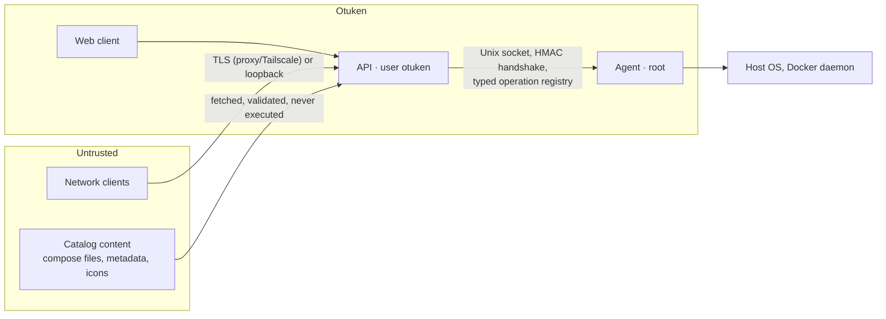

# Otuken security model

Otuken manages a server: anyone who controls an administrator session can, by design, change the
host. The security model therefore concentrates on (1) making sure only the right people get a
session, (2) limiting what each role can do, (3) keeping the privileged component small and
non-generic, and (4) leaving an audit trail.

Status legend: **[P1]** implemented and tested in Phase 1, **[planned]** designed but not yet
implemented.

## Trust boundaries

| Boundary       | Control                                                                                                                            |
| -------------- | ---------------------------------------------------------------------------------------------------------------------------------- |
| Network → API  | Loopback-only default bind, session cookies, CSRF defenses, rate limiting, strict input validation, security headers **[P1]**      |
| API → Agent    | Socket file permissions + mutual HMAC handshake, operation allowlist, zod validation, per-operation permission and policy **[P1]** |
| Catalogs → API | SSRF-safe fetch, size and time limits, no script execution, install policy checks **[planned, Phase 5]**                           |
| Web client     | No privileged logic; strict CSP; untrusted text rendered as text, never as HTML **[P1]**                                           |

## Network exposure

- The API binds to `127.0.0.1:7470` by default **[P1]**. Exposing it on the LAN or a Tailscale
  address is an explicit configuration change (`server.host`), and the API logs a warning when it
  listens on a non-loopback address without TLS **[P1]**.
- Recommended remote access is through Tailscale (`tailscale serve`) or a TLS reverse proxy. Direct
  TLS is supported with `server.tls` **[P1]**.
- `X-Forwarded-For`, `X-Forwarded-Proto` and `X-Forwarded-Host` are honoured only when the direct
  peer is listed in `server.trustedProxies` (IPs or CIDRs). The client address is the first
  untrusted hop from the right **[P1]**.
- The UI warns when the connection is plain HTTP from a non-loopback address; plain HTTP is never
  silently treated like HTTPS **[P1]**.
- Otuken never opens firewall ports **[policy]**.

## Authentication

| Mechanism                | Details                                                                                                                                                                                                                                                                                                                                                    |
| ------------------------ | ---------------------------------------------------------------------------------------------------------------------------------------------------------------------------------------------------------------------------------------------------------------------------------------------------------------------------------------------------------- |
| First-run setup **[P1]** | `POST /api/setup` works only while no user exists, and requires a one-time token. The token is written to `/var/lib/otuken/setup-token` (mode 0600) and is readable only by the `otuken` user and root. The token file is deleted after setup and the endpoint answers `409` from then on. Admin creation re-checks "no users" inside a write transaction. |
| Passwords **[P1]**       | scrypt (N=2¹⁶, r=8, p=2, 16-byte salt, self-describing format with transparent rehash when parameters increase). Unicode NFKC normalization. The policy requires 10–256 characters, rejects passwords that contain the username or are common, and rejects repetitive ones.                                                                                |
| Timing **[P1]**          | Unknown usernames run a dummy verification so response time does not reveal which accounts exist. Unknown user and wrong password return the same error.                                                                                                                                                                                                   |
| Sessions **[P1]**        | 256-bit random token in an `HttpOnly`, `SameSite=Strict` cookie (`__Host-` prefix and `Secure` over HTTPS). Only the SHA-256 of the token is stored. Sessions have a 12 h idle timeout and a 7-day absolute lifetime (both configurable). Logout, password change, account disabling and admin password resets revoke sessions server-side.                |
| Second factor **[P1]**   | Optional TOTP (RFC 6238, SHA-1, 30 s, 6 digits, ±1 step) with replay protection: the last accepted step is persisted. The challenge is bound to the client IP, valid for 5 minutes, and allows at most 5 attempts. Users get 10 single-use recovery codes, stored as hashes. Disabling 2FA requires the password and a valid code.                         |
| Brute force **[P1]**     | In-memory progressive lockouts per IP (20 failures / 15 min) and per account (5 failures, lock starting at 1 min, doubling up to 15 min). Re-authentication inside a session is limited separately. Lockouts are temporary by design, so an attacker cannot permanently lock out the administrator.                                                        |

## Authorization

- Roles are bundles of fine-grained permissions (`packages/shared/src/permissions.ts`) **[P1]**:
  - **admin**: all permissions.
  - **operator**: day-to-day operations (services, Docker, apps, files, backups, tasks, logs). No user
    management, settings, catalog trust, terminal or audit log.
  - **viewer**: read-only system, services, Docker, apps and notifications.
- Every route declares the permission it needs (`requirePermission`). Permissions are recomputed
  from the user's current role on each request, so role changes and disabling take effect
  immediately **[P1]**.
- Administrators cannot demote, disable or delete themselves, and the last active administrator is
  protected **[P1]**.
- The UI hides actions a user cannot perform, but hiding is never the control. The API and the agent
  enforce permissions independently **[P1]**.
- `preferences:manage` is available to all roles for their own desktop and wallpapers **[P2]**.
  Every operation derives ownership from the session, never from a submitted user id. Viewers
  retain read-only access to host resources.

## Desktop session locking **[P2]**

The API persists the lock on the session row. Locked sessions cannot query host data, administer
users, access audit logs, change account security or mutate preferences. Unlock requires the
current password with re-authentication rate limiting; lock/unlock outcomes are audited. Logging
out remains possible. Public health/bootstrap, session probing, preference reads and owned
wallpaper images are the explicit read exceptions needed to render the lock screen after reload.
The client's inactivity timer is a convenience, not a replacement for server session expiry.

Wallpaper uploads stream under a hard size limit, inspect supported raster headers and dimensions,
enforce per-user quotas, and never accept SVG/HTML. Theme files are parsed as bounded data, never
executed or dynamically imported. Security preference changes and wallpaper deletion are audited
without storing secrets or image content in event details.

## CSRF and browser hardening **[P1]**

For state-changing requests:

1. Requests whose `Sec-Fetch-Site` is not `same-origin` or `none` are rejected.
2. If `Origin` is present, it must equal the origin the browser used (derived from `Host`, or from
   trusted forwarded headers) or one of `server.publicOrigins`.
3. Authenticated requests must send `X-Otuken-CSRF`, whose value is
   HMAC(server key, session id). The credential-submission endpoints (setup, login) need no token
   but still pass the origin checks.

Every response carries a strict CSP (`script-src 'self'`, `object-src 'none'`,
`frame-ancestors 'none'`, `base-uri 'none'`), along with `X-Content-Type-Options: nosniff`,
`X-Frame-Options: DENY`, `Referrer-Policy: no-referrer`, COOP/CORP and a restrictive
`Permissions-Policy`. API responses are `Cache-Control: no-store`. JSON bodies are limited to
64 KiB, and unknown fields are rejected (`z.strictObject`).

## Secrets at rest **[P1]**

- `/var/lib/otuken/secret.key` holds a 256-bit master key, created on first start with mode 0600.
  HKDF-SHA256 derives independent subkeys per purpose (`otuken/secret-box/v1`, `otuken/csrf/v1`, …).
- Secrets that must be recoverable (TOTP seeds now, application API tokens later) are encrypted
  with AES-256-GCM. The ciphertext is bound to its row and purpose through additional
  authenticated data (for example `user:<id>:totp`), so it cannot be copied to another user.
- Key files are refused if they are group-writable or accessible by "other".
- **Backups:** a database backup without `secret.key` keeps encrypted secrets unreadable. The Phase 7
  backup feature will handle the key explicitly (opt-in, encrypted export).

## The privileged agent

The agent is the only component with root privileges. Its interface is deliberately narrow:

- **Transport [P1]:** Unix domain socket only, never TCP. In production the socket is
  `root:otuken 0660` inside `/run/otuken` (`root:otuken 0750`). The socket is created under a
  restrictive umask, so it is never briefly world-accessible.
- **Peer authentication [P1]:** Node.js cannot read `SO_PEERCRED`. Peer identity is enforced at
  group level instead: filesystem permissions allow only `root` and the `otuken` group to connect,
  and a mutual HMAC-SHA256 challenge–response proves possession of `/etc/otuken/agent.key`
  (`root:otuken 0640`, created by the agent). The agent also proves the key back, so the API never
  talks to an impostor socket. Unauthenticated peers get a single `fatal` frame and are disconnected
  after 5 s at most.
- **Operation registry [P1]:** the agent executes only operations defined in
  `packages/agent-protocol/src/operations.ts`. Each operation has a zod parameter schema, a result
  schema (results are validated before they are sent), a required permission, a timeout, and a
  `mutating` flag that triggers audit logging. There is **no generic command execution operation**,
  and none will be added.
- **Defense in depth [P1]:** every request carries the acting user (id, username, role, session,
  IP). The agent re-derives permissions from the role and evaluates an operation policy
  (`apps/agent/src/policy.ts`). For example, a later rule will refuse to stop `ssh`, `otuken-agent`
  or other protected units regardless of role. Unknown roles or malformed frames close the
  connection.
- **Resource limits [P1]:** at most 4 connections, 16 in-flight requests per connection, 1 MiB per
  frame, and per-operation timeouts with cancellation (`AbortSignal`) when the API disconnects.
  Unexpected handler errors return a generic message and never leak internals.
- **Configuration [P1]:** the agent reads only root-owned configuration (`/etc/otuken/agent.yaml`)
  and never trusts files that the `otuken` user can write.
- **systemd hardening [planned, Phase 8]:** `ProtectSystem`, `ProtectHome`, `PrivateTmp`,
  `NoNewPrivileges` (where compatible with the operation set), `RestrictAddressFamilies=AF_UNIX`,
  `KillMode=control-group` (so no child process outlives the agent), plus `MemoryMax` and
  `TasksMax`.

**Residual risk.** A fully compromised API process can ask the agent for any operation that an
administrator could request. The agent's operation registry and policy bound the damage, but they
cannot prevent it entirely. This is inherent to a web-managed server and is why the API runs
unprivileged and exposes a small attack surface.

## Development mode

- `OTUKEN_ENV=development` keeps all state in `./.dev` with 0600 keys and sockets.
- The dev orchestrator and the agent refuse to run as root, so development never holds real
  privileges.
- The setup token is printed to the console only in development mode. In production the log line
  names the file instead.

## Audit log **[P1]**

Security-relevant actions are written to `audit_events` and mirrored to journald: setup, login
(success, failure and reason), second-factor failures, logout, session revocation, password
changes and resets, 2FA changes, and user administration. Entries record actor, IP, target and
outcome, but never secrets. Retention is 180 days or 100 000 rows, whichever limit is reached first.
The agent logs every mutating and every denied operation with the actor identity.

## Reporting vulnerabilities

See [SECURITY.md](../SECURITY.md).
